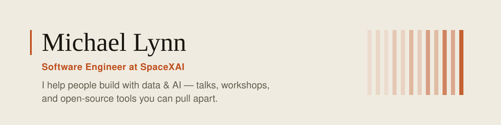

<div align="center">

<picture>
  <source media="(prefers-color-scheme: dark)" srcset="assets/hero-dark.svg">
  <source media="(prefers-color-scheme: light)" srcset="assets/hero-light.svg">
  
</picture>

**[mlynn.org](https://mlynn.org)** · **[Writing](https://mlynn.org/blog)** · **[Speaking](https://mlynn.org/speaking)** · **[LinkedIn](https://www.linkedin.com/in/mlynn/)** · **[X](https://twitter.com/mlynn)**

</div>

<br>

I'm a software engineer at SpaceXAI, working on GTM, revenue operations, and the internal
tools Customer Success runs on. Alongside that: fifteen years of talks, workshops, and
open-source projects, and I still do the advocacy and advisory work.

The through-line is the same either way — build the thing that makes a system legible to
the person who has to act on it. What a read costs. Where a model's confidence stops
meaning anything. Which ticket has been sitting too long. The projects below are the
public half of that, and each one is something you can open in a browser before you
decide whether to clone it.

---

## LanceScope

**A workbench for reading LanceDB datasets** — schema, versions, indices, fragments and
rows, with the byte cost of every read shown as you go.

<a href="https://github.com/mrlynn/lancescope">
  
</a>

A Lance table can hold 2.65 GB of video while a search over it reads none of it. The
bytes a search touches and the bytes a table holds live in different files, and almost
nothing shows you both. This does — and then it says what it already knows: ten rules
over metadata, each carrying the numbers it was derived from. No model is asked, so
nothing there costs a token.

[**Website**](https://lancescope.mlynn.dev) · [**Live console**](https://demo.lancescope.mlynn.dev/console) · [**Docs**](https://lancescope.mlynn.dev/docs) · [**Repo**](https://github.com/mrlynn/lancescope)

<sub>Python 3.12 · FastAPI · Next.js 16 · 8 pinned Lance readers on ghcr.io · 8 read-only MCP tools · a signed macOS app</sub>

---

## Claude Triage API

**Learn the Claude API by building a real support-triage service** — structured outputs,
tool use, streaming, prompt caching, and evals. Eleven labs, a Python track, an
instructor kit, and a storefront where your own words get classified live.

<table>
<tr>
<td width="50%">
<a href="https://northwind.mlynn.dev">
  
</a>
<sub><b>The shop.</b> File a ticket and watch it get triaged, then try to break the classifier.</sub>
</td>
<td width="50%">
<a href="https://triage.mlynn.dev/playground">
  
</a>
<sub><b>The playgrounds.</b> Seven of them, rendering real runs rather than illustrations of runs.</sub>
</td>
</tr>
</table>

Four routes, four capabilities, one coherent domain — each route introducing exactly one
new idea and building on the one before it. The scenario is a company with 4,100 support
tickets a week and an incident where a child's injury report sat unrouted for three days
because it opened with "probably nothing." Every design decision traces back to that page.

Day 1 is about four hours and leaves you with a service you can show. Day 2 is for people
who are going to ship: which model, what happens when the input is hostile, and what
separates a demo from a service.

[**Take the course**](https://triage.mlynn.dev) · [**Visit the shop**](https://northwind.mlynn.dev) · [**Watch the intro**](https://youtu.be/fhsAmotYggs) · [**Repo**](https://github.com/mrlynn/claude-triage-api)

<sub>TypeScript · FastAPI (Python track) · Next.js · Docusaurus · an eval harness with deterministic scoring and an LLM judge</sub>

---

## VAI — Voyage AI Toolkit

**End-to-end RAG pipelines** on Voyage AI embeddings and MongoDB Atlas Vector Search.
One command takes a directory of documents to a searchable vector database:

```bash
npm i -g voyageai-cli
vai pipeline ./docs/
```

Five chunking strategies, two-stage retrieval (embed → vector search → rerank), eight
benchmark subcommands covering latency, cost, asymmetric retrieval and quantization, and
an interactive playground for the parts that are easier to see than to read about.

[**vaicli.com**](https://vaicli.com) · [**Docs**](https://docs.vaicli.com) · [**npm**](https://www.npmjs.com/package/voyageai-cli) · [**Repo**](https://github.com/mrlynn/voyageai-cli)

<sub>Community tool — not an official MongoDB or Voyage AI product.</sub>

---

## Also on the bench

| | |
|---|---|
| [**NetPad**](https://netpad.io) | Agentic workflow diagramming and builder |
| [**MermaidGPT**](https://mermaidgpt.com) | Mermaid diagrams from a sentence |
| [**AI Project Mapper**](https://github.com/mrlynn/ai-project-mapper) | LLM-friendly project summaries, so an assistant can understand a codebase it has not read |
| [**mongodb-erd**](https://github.com/mrlynn/mongodb-erd) | Entity-relationship diagrams inferred from a live MongoDB database |
| [**MongoDB-RAG**](https://mongodb-developer.github.io/mongodb-rag) | Similarity search, caching and retrieval as a library |
| [**MacFaceSwap**](https://github.com/mrlynn/MacFaceSwap) | Face swapping on a Mac, because someone asked |

[**All projects →**](https://mlynn.org/projects)

---

## Speaking, teaching, and the podcast

200+ talks, 50K+ developers, and a strong preference for the kind where everyone opens a
terminal. **AWS re:Invent** — a lightning talk on the evolution of data to intelligence.
**MongoDB Developer Days** — hands-on training, run worldwide. **The MongoDB Podcast** —
co-host, on AI, developer tools, and databases.

If you have something to build or want to dig into a collaboration:
[**book a time →**](https://mlynn.org)

---

<div align="center">
<sub><i>The best way to learn a technology is to build something real with it.</i></sub>
</div>
